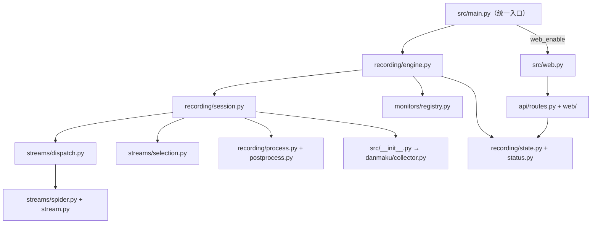

# 架构与实现

[文档导航](../README.md) · [目录与文件职责](../agent-reference/project-structure.md) · [开发指南](../development.md)

本文描述当前系统与职责边界；功能、支持平台、配置示例和启动操作统一见 [README](../../README.md)，不在架构文档复制。版本与依赖以 [pyproject.toml](../../pyproject.toml) 和 [uv.lock](../../uv.lock) 为准。

## 专题索引

| 专题 | 内容 |
| --- | --- |
| [录制与调度](recording.md) | 入口初始化、房间会话、共享状态、并发容量与 host 熔断 |
| [平台解析与画质](platforms.md) | 平台接口、抖音 URL 分流、流数据契约、画质回采与解析兜底 |
| [配置存储](configuration.md) | TOML 校验、INI 迁移、原子写入、热加载及主播改名 |
| [网络与凭据](network.md) | HTTP 客户端、TLS、凭据去重、出站校验与安全边界 |
| [Web 面板与接口](web.md) | 引擎线程、API 路由、后台模式、前端与认证 |
| [弹幕与字幕](danmaku.md) | 平台协议、采集器、SRT 写入及实时监控 |
| [共用支撑](support.md) | 工具归属、日志、通知、国际化及外部运行时 |
| [构建与发布](../build-and-release.md) | 打包资源、冒烟、CI、发行归档与镜像 |

## 整体架构

纯录制与面板模式共用录制引擎和状态。图中省略日志、配置、网络及外部运行时等公共支撑连线。

## 工作流程与依赖边界

1. 统一入口设置终端编码、迁移旧配置，再按 `[Web] web_enable` 选择纯录制或面板模式；面板实现不提供第二个启动入口。
2. 引擎读取主配置与房间列表，检查 FFmpeg / Node、初始化退出协调及备份任务，随后热加载配置并调度房间。
3. 每房间一个线程，在各自 `asyncio.run()` 中执行平台请求；没有全局共享事件循环。平台分派归一化 URL，获取直播数据并解析流地址和画质，选源层验证候选。
4. 单房间会话启动并监控 FFmpeg（或直下），反馈结果并触发通知；录制结束执行后处理。弹幕链与视频解析平行，经工厂与会话同起同停。
5. Web API 经共享状态、状态快照与配置接口管理引擎；业务模块不反向导入 CLI / Web 入口。配置文件写入共用 `state.file_update_lock`。
6. `support/` 和 `app/` 不依赖录制状态，网络层不导入 API；配置操作归 `config/`，JS 执行归 `runtime/`，URL/Cookie 格式处理归 `network/urls.py`，平台异常兜底归 `streams/errors.py`。

源码文件的完整列表只在 [项目结构](../agent-reference/project-structure.md) 维护。

## 技术与设计取舍

- Python 3.14+ 驱动房间线程与线程内 asyncio；httpx 执行平台 HTTP 请求，websockets 承担弹幕传输。
- FFmpeg 录制及转封装；Node.js 经 exejs / PyExecJS 运行签名算法。下载与校验信息集中在 [外部资源清单](../../src/external_resources.json)。
- Web 使用 Starlette + uvicorn 和原生 HTML/CSS/JavaScript；配置存储使用 tomlkit，配置值由 pydantic 校验，API 请求模型另由 dataclass 校验。
- protobuf 解码抖音弹幕，brotli 解压 B站弹幕；Loguru 统一日志，中文源码原文配英文 JSON 目录完成本地化。
- 平台 API 通过适配器统一流数据；同步/异步装饰器集中处理解析异常。录制会话共用检测 → 取流 → 录制 → 通知模板，通知渠道按配置选择独立函数。
- 弹幕通过注册表和工厂创建平台客户端；日志配置在模块中共享，弹幕监控枢纽惰性取得进程级实例。这些共享实例不代表共享跨线程的 asyncio 事件循环。

约束与回归细节统一见 [AGENTS](../../AGENTS.md) 和 [已知坑](../agent-reference/known-pitfalls.md)；带日期的实现变化见 [实现变更记录](../changelog/implementation-notes.md)。

> 继续：[项目结构](../agent-reference/project-structure.md) / [构建与发布](../build-and-release.md)；返回[文档导航](../README.md)。
